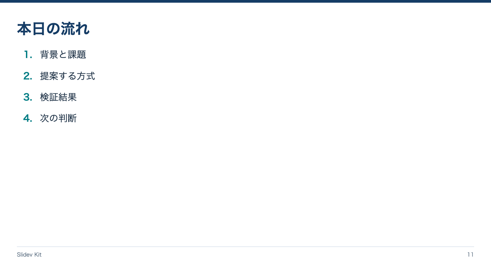

<!-- Generated by npm run catalog; edit packages/core/registry/layouts.json -->
# アジェンダ / `agenda`

説明の順序を番号付きで伝える

カテゴリ: 構成・本文



## コピーして使う

Corporateデッキの末尾へ、そのまま貼り付けてください。[初回セットアップ](../../docs/phase1/phase1-usage.md)。

[Markdownファイル](../templates/agenda.md)

````md
---
layout: agenda
variant: balanced
density: normal
---

# 本日の流れ

1. 背景と課題
2. 提案する方式
3. 検証結果
4. 次の判断
````

## 設定・情報量

- Variant: `balanced`（既定: `balanced`）
- Density: `relaxed`, `normal`, `compact`（既定: `normal`）
- 情報量目安: 順序付き3〜6項目、各補足1行まで
- 名前付きslot: なし。本文をそのまま使用

## 注意点

- Corporate / Editorial専用のKit契約。H1はちょうど1つ、named slotより前に置く。
- 情報量目安を超えた場合は警告を確認し、内容を削除・省略・自動縮小しない。

## AI向けメタデータ

以下は人間向けカタログと同じレジストリから生成しています。AIなしで利用できます。

```json
{
  "id": "agenda",
  "name": "アジェンダ",
  "category": "presentation",
  "description": "説明の順序を番号付きで伝える",
  "use_cases": [
    "agenda"
  ],
  "slots": [],
  "variants": [
    "balanced"
  ],
  "density": [
    "relaxed",
    "normal",
    "compact"
  ],
  "content_guide": "順序付き3〜6項目、各補足1行まで",
  "notes": [
    "Corporate / Editorial専用のKit契約。H1はちょうど1つ、named slotより前に置く。",
    "情報量目安を超えた場合は警告を確認し、内容を削除・省略・自動縮小しない。"
  ],
  "template": "catalog/templates/agenda.md",
  "preview": "catalog/previews/agenda.png"
}
```
