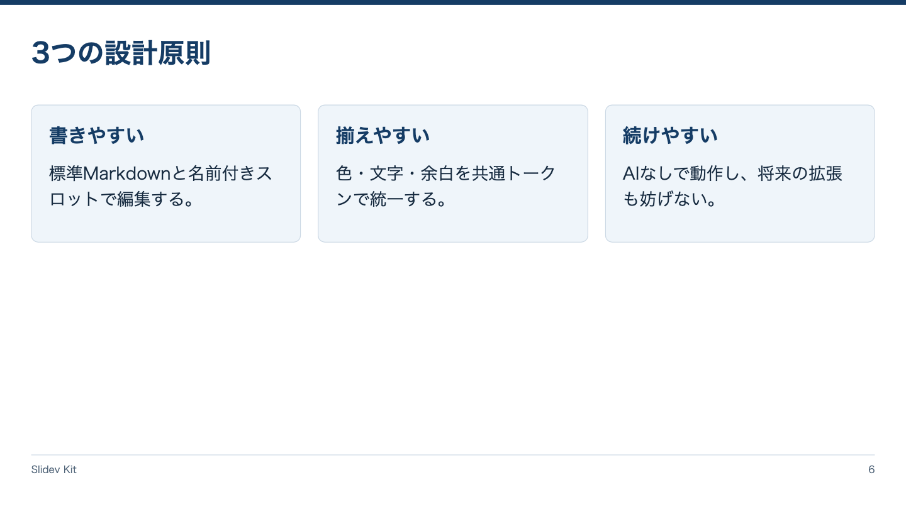

<!-- Generated by npm run catalog; edit packages/theme/registry/layouts.json -->
# カード一覧 / `cards`

3つの独立した特徴を一覧にする

カテゴリ: 情報整理



## コピーして使う

Corporateデッキの末尾へ、そのまま貼り付けてください。[初回セットアップ](../../docs/phase1/phase1-usage.md)。

[Markdownファイル](../templates/cards.md)

````md
---
layout: cards
variant: balanced
density: normal
---

# 3つの設計原則

::first::

## 書きやすい

標準Markdownと名前付きスロットで編集する。

::second::

## 揃えやすい

色・文字・余白を共通トークンで統一する。

::third::

## 続けやすい

AIなしで動作し、将来の拡張も妨げない。
````

## 設定・情報量

- Variant: `balanced`（既定: `balanced`）
- Density: `relaxed`, `normal`, `compact`（既定: `normal`）
- 情報量目安: 3カード固定。各カード見出し1つ、本文2〜4行
- 名前付きslot: `first`（必須: 1枚目）, `second`（必須: 2枚目）, `third`（必須: 3枚目）

## 注意点

- カード数可変や入れ子構造はPhase 1の対象外。

## AI向けメタデータ

以下は人間向けカタログと同じレジストリから生成しています。AIなしで利用できます。

```json
{
  "id": "cards",
  "name": "カード一覧",
  "category": "information",
  "description": "3つの独立した特徴を一覧にする",
  "use_cases": [
    "features",
    "benefits",
    "pillars"
  ],
  "slots": [
    {
      "name": "first",
      "required": true,
      "description": "1枚目"
    },
    {
      "name": "second",
      "required": true,
      "description": "2枚目"
    },
    {
      "name": "third",
      "required": true,
      "description": "3枚目"
    }
  ],
  "variants": [
    "balanced"
  ],
  "density": [
    "relaxed",
    "normal",
    "compact"
  ],
  "content_guide": "3カード固定。各カード見出し1つ、本文2〜4行",
  "notes": [
    "カード数可変や入れ子構造はPhase 1の対象外。"
  ],
  "template": "catalog/templates/cards.md",
  "preview": "catalog/previews/cards.png"
}
```
