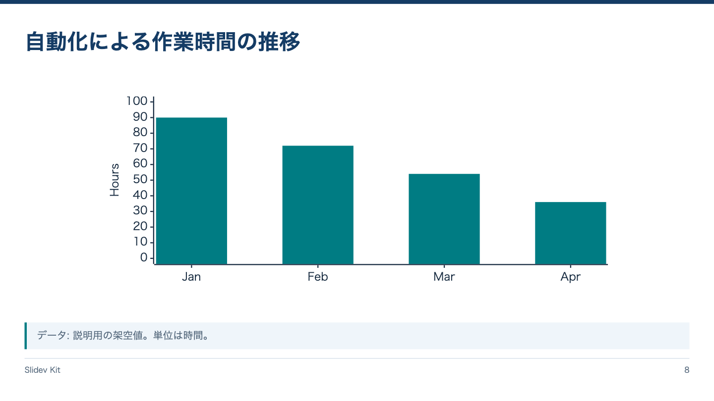
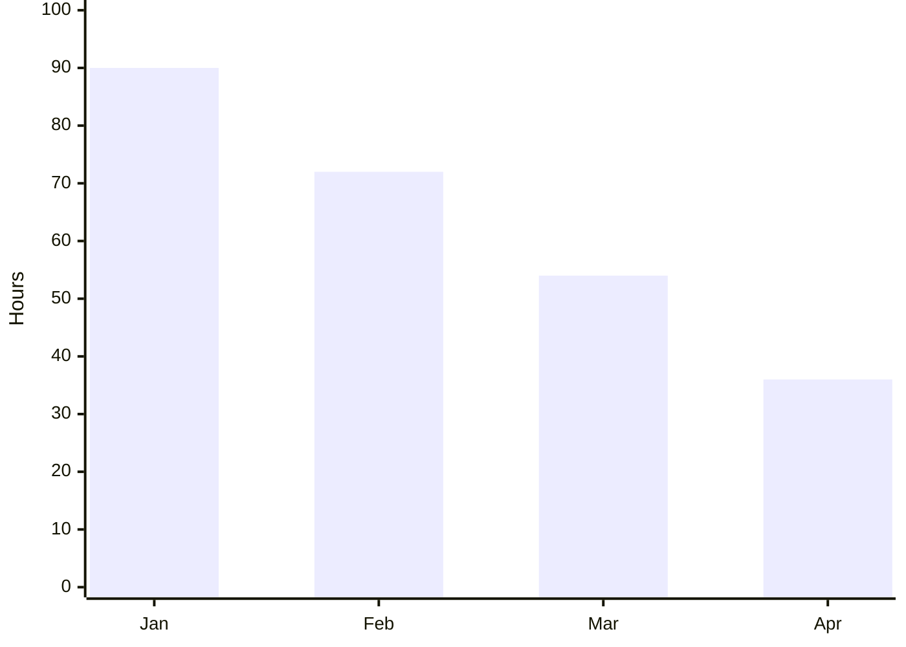

<!-- Generated by npm run catalog; edit packages/theme/registry/layouts.json -->
# グラフ中心 / `chart`

標準Mermaidで数値の傾向を示す

カテゴリ: 図・分析



## コピーして使う

Corporateデッキの末尾へ、そのまま貼り付けてください。[初回セットアップ](../../docs/phase1/phase1-usage.md)。

[Markdownファイル](../templates/chart.md)

````md
---
layout: chart
variant: balanced
density: normal
---

# 自動化による作業時間の推移



> データ: 説明用の架空値。単位は時間。
````

## 設定・情報量

- Variant: `balanced`（既定: `balanced`）
- Density: `relaxed`, `normal`, `compact`（既定: `normal`）
- 情報量目安: グラフ1点、4〜8データ点、出典1行
- 名前付きslot: なし。本文をそのまま使用

## 注意点

- Phase 1はSlidev標準のMermaid xychart-betaを使う。
- 値と軸の単位を明示する。グラフ構文の誤りはMermaidのエラーとして表示される。

## AI向けメタデータ

以下は人間向けカタログと同じレジストリから生成しています。AIなしで利用できます。

```json
{
  "id": "chart",
  "name": "グラフ中心",
  "category": "analysis",
  "description": "標準Mermaidで数値の傾向を示す",
  "use_cases": [
    "trend",
    "measurement",
    "results"
  ],
  "slots": [],
  "variants": [
    "balanced"
  ],
  "density": [
    "relaxed",
    "normal",
    "compact"
  ],
  "content_guide": "グラフ1点、4〜8データ点、出典1行",
  "notes": [
    "Phase 1はSlidev標準のMermaid xychart-betaを使う。",
    "値と軸の単位を明示する。グラフ構文の誤りはMermaidのエラーとして表示される。"
  ],
  "template": "catalog/templates/chart.md",
  "preview": "catalog/previews/chart.png"
}
```
