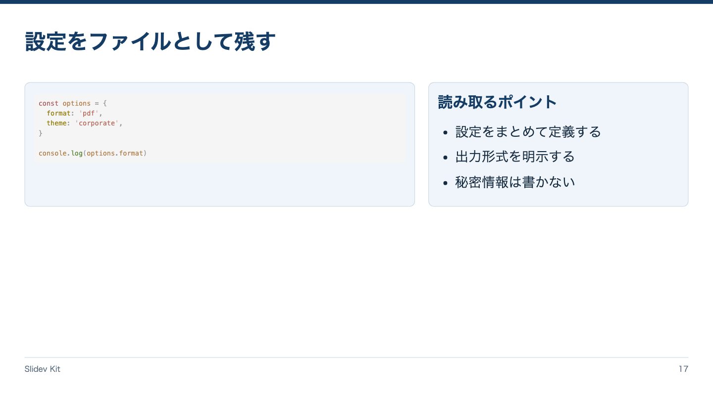

<!-- Generated by npm run catalog; edit packages/core/registry/layouts.json -->
# コード解説 / `code`

実行せずコードと解説を並べる

カテゴリ: 構造



## コピーして使う

Corporateデッキの末尾へ、そのまま貼り付けてください。[初回セットアップ](../../docs/phase1/phase1-usage.md)。

[Markdownファイル](../templates/code.md)

````md
---
layout: code
variant: balanced
density: normal
---

# 設定をファイルとして残す

::code::

```js
const options = {
  format: 'pdf',
  theme: 'corporate',
}

console.log(options.format)
```

::explanation::

## 読み取るポイント

- 設定をまとめて定義する
- 出力形式を明示する
- 秘密情報は書かない
````

## 設定・情報量

- Variant: `balanced`（既定: `balanced`）
- Density: `relaxed`, `normal`, `compact`（既定: `normal`）
- 情報量目安: コード8〜14行、解説3項目まで
- 名前付きslot: `code`（必須: 標準fenceのコード）, `explanation`（必須: 解説）

## 注意点

- Corporate / Editorial専用のKit契約。H1はちょうど1つ、named slotより前に置く。
- 情報量目安を超えた場合は警告を確認し、内容を削除・省略・自動縮小しない。

## AI向けメタデータ

以下は人間向けカタログと同じレジストリから生成しています。AIなしで利用できます。

```json
{
  "id": "code",
  "name": "コード解説",
  "category": "structure",
  "description": "実行せずコードと解説を並べる",
  "use_cases": [
    "code"
  ],
  "slots": [
    {
      "name": "code",
      "required": true,
      "description": "標準fenceのコード"
    },
    {
      "name": "explanation",
      "required": true,
      "description": "解説"
    }
  ],
  "variants": [
    "balanced"
  ],
  "density": [
    "relaxed",
    "normal",
    "compact"
  ],
  "content_guide": "コード8〜14行、解説3項目まで",
  "notes": [
    "Corporate / Editorial専用のKit契約。H1はちょうど1つ、named slotより前に置く。",
    "情報量目安を超えた場合は警告を確認し、内容を削除・省略・自動縮小しない。"
  ],
  "template": "catalog/templates/code.md",
  "preview": "catalog/previews/code.png"
}
```
