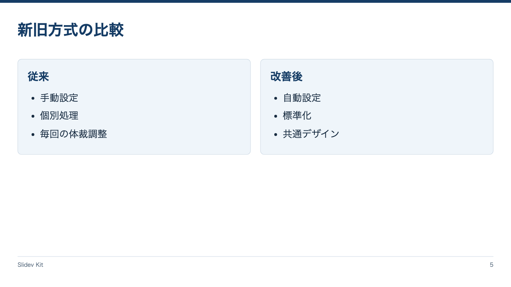

<!-- Generated by npm run catalog; edit packages/core/registry/layouts.json -->
# 対比 / `comparison`

2つの対象の違いを同じ観点で示す

カテゴリ: 比較・論理



## コピーして使う

Corporateデッキの末尾へ、そのまま貼り付けてください。[初回セットアップ](../../docs/phase1/phase1-usage.md)。

[Markdownファイル](../templates/comparison.md)

````md
---
layout: comparison
variant: balanced
density: normal
---

# 新旧方式の比較

::left::

## 従来

- 手動設定
- 個別処理
- 毎回の体裁調整

::right::

## 改善後

- 自動設定
- 標準化
- 共通デザイン
````

## 設定・情報量

- Variant: `balanced`, `left`, `right`（既定: `balanced`）
- Density: `relaxed`, `normal`, `compact`（既定: `normal`）
- 情報量目安: 各側3〜4項目。同じ比較観点で揃える
- 名前付きslot: `left`（必須: 比較元）, `right`（必須: 比較先）

## 注意点

- 一方だけ情報を増やさず、対応関係が分かるようにする。

## AI向けメタデータ

以下は人間向けカタログと同じレジストリから生成しています。AIなしで利用できます。

```json
{
  "id": "comparison",
  "name": "対比",
  "category": "logic",
  "description": "2つの対象の違いを同じ観点で示す",
  "use_cases": [
    "before_after",
    "alternatives",
    "trade_offs"
  ],
  "slots": [
    {
      "name": "left",
      "required": true,
      "description": "比較元"
    },
    {
      "name": "right",
      "required": true,
      "description": "比較先"
    }
  ],
  "variants": [
    "balanced",
    "left",
    "right"
  ],
  "density": [
    "relaxed",
    "normal",
    "compact"
  ],
  "content_guide": "各側3〜4項目。同じ比較観点で揃える",
  "notes": [
    "一方だけ情報を増やさず、対応関係が分かるようにする。"
  ],
  "template": "catalog/templates/comparison.md",
  "preview": "catalog/previews/comparison.png"
}
```
