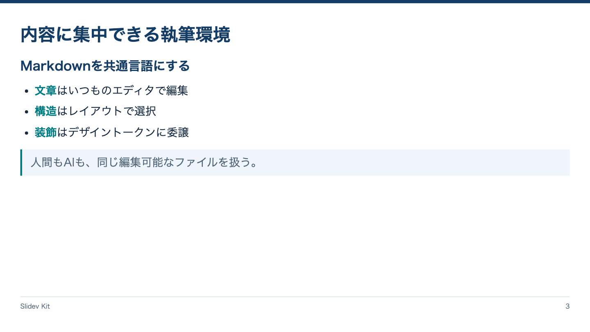

<!-- Generated by npm run catalog; edit packages/theme/registry/layouts.json -->
# 標準本文 / `content`

文章と箇条書きで要点を説明する

カテゴリ: 構成・本文



## コピーして使う

Corporateデッキの末尾へ、そのまま貼り付けてください。[初回セットアップ](../../docs/phase1/phase1-usage.md)。

[Markdownファイル](../templates/content.md)

````md
---
layout: content
variant: balanced
density: normal
---

# 内容に集中できる執筆環境

## Markdownを共通言語にする

- **文章**はいつものエディタで編集
- **構造**はレイアウトで選択
- **装飾**はデザイントークンに委譲

> 人間もAIも、同じ編集可能なファイルを扱う。
````

## 設定・情報量

- Variant: `balanced`（既定: `balanced`）
- Density: `relaxed`, `normal`, `compact`（既定: `normal`）
- 情報量目安: 見出し1つ、箇条書き3〜5項目。compactでも7項目程度まで
- 名前付きslot: なし。本文をそのまま使用

## 注意点

- 長文を無理に詰めず複数スライドに分ける。
- Corporateでは本文のみを使用する。既存のcolumns/autoFitは従来デザイン向け。

## AI向けメタデータ

以下は人間向けカタログと同じレジストリから生成しています。AIなしで利用できます。

```json
{
  "id": "content",
  "name": "標準本文",
  "category": "presentation",
  "description": "文章と箇条書きで要点を説明する",
  "use_cases": [
    "explanation",
    "progress_report"
  ],
  "slots": [],
  "variants": [
    "balanced"
  ],
  "density": [
    "relaxed",
    "normal",
    "compact"
  ],
  "content_guide": "見出し1つ、箇条書き3〜5項目。compactでも7項目程度まで",
  "notes": [
    "長文を無理に詰めず複数スライドに分ける。",
    "Corporateでは本文のみを使用する。既存のcolumns/autoFitは従来デザイン向け。"
  ],
  "template": "catalog/templates/content.md",
  "preview": "catalog/previews/content.png"
}
```
