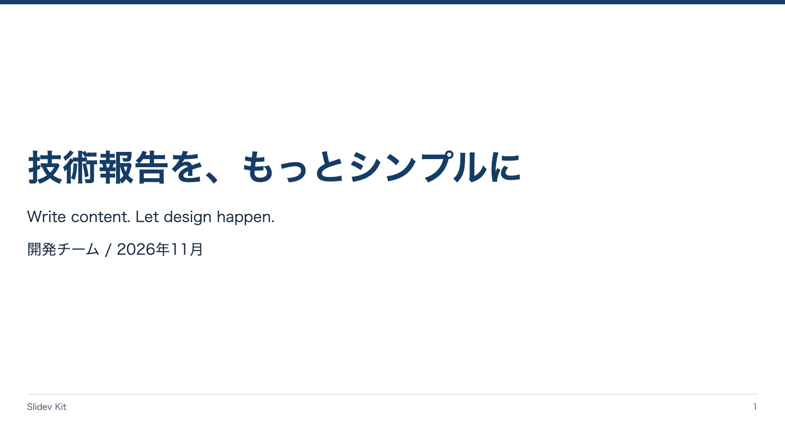

<!-- Generated by npm run catalog; edit packages/theme/registry/layouts.json -->
# 表紙 / `cover`

資料のタイトルと発表者を伝える

カテゴリ: 構成・本文



## コピーして使う

Corporateデッキの末尾へ、そのまま貼り付けてください。[初回セットアップ](../../docs/phase1/phase1-usage.md)。

[Markdownファイル](../templates/cover.md)

````md
---
layout: cover
variant: balanced
density: normal
---

# 技術報告を、もっとシンプルに

Write content. Let design happen.

開発チーム / 2026年11月
````

## 設定・情報量

- Variant: `balanced`, `dramatic`（既定: `balanced`）
- Density: `relaxed`, `normal`, `compact`（既定: `normal`）
- 情報量目安: タイトル1〜2行、副題1行、発表者・日付各1行
- 名前付きslot: なし。本文をそのまま使用

## 注意点

- タイトルは本文のH1で記述する。従来デザインのtitle指定方式とは異なる。

## AI向けメタデータ

以下は人間向けカタログと同じレジストリから生成しています。AIなしで利用できます。

```json
{
  "id": "cover",
  "name": "表紙",
  "category": "presentation",
  "description": "資料のタイトルと発表者を伝える",
  "use_cases": [
    "opening",
    "technical_report"
  ],
  "slots": [],
  "variants": [
    "balanced",
    "dramatic"
  ],
  "density": [
    "relaxed",
    "normal",
    "compact"
  ],
  "content_guide": "タイトル1〜2行、副題1行、発表者・日付各1行",
  "notes": [
    "タイトルは本文のH1で記述する。従来デザインのtitle指定方式とは異なる。"
  ],
  "template": "catalog/templates/cover.md",
  "preview": "catalog/previews/cover.png"
}
```
