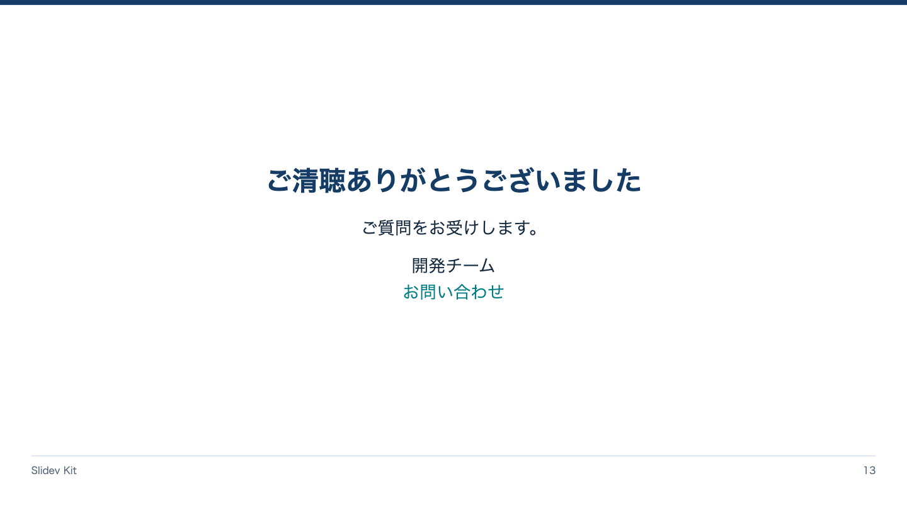

<!-- Generated by npm run catalog; edit packages/theme/registry/layouts.json -->
# 締め / `end`

締めの言葉と問い合わせ先を残す

カテゴリ: 構成・本文



## コピーして使う

Corporateデッキの末尾へ、そのまま貼り付けてください。[初回セットアップ](../../docs/phase1/phase1-usage.md)。

[Markdownファイル](../templates/end.md)

````md
---
layout: end
variant: balanced
density: normal
---

# ご清聴ありがとうございました

ご質問をお受けします。

開発チーム\
[お問い合わせ](mailto:team@example.com)
````

## 設定・情報量

- Variant: `balanced`（既定: `balanced`）
- Density: `relaxed`, `normal`, `compact`（既定: `normal`）
- 情報量目安: H1、締め1行、連絡先1〜2行
- 名前付きslot: なし。本文をそのまま使用

## 注意点

- Corporate / Editorial専用のKit契約。H1はちょうど1つ、named slotより前に置く。
- 情報量目安を超えた場合は警告を確認し、内容を削除・省略・自動縮小しない。

## AI向けメタデータ

以下は人間向けカタログと同じレジストリから生成しています。AIなしで利用できます。

```json
{
  "id": "end",
  "name": "締め",
  "category": "presentation",
  "description": "締めの言葉と問い合わせ先を残す",
  "use_cases": [
    "end"
  ],
  "slots": [],
  "variants": [
    "balanced"
  ],
  "density": [
    "relaxed",
    "normal",
    "compact"
  ],
  "content_guide": "H1、締め1行、連絡先1〜2行",
  "notes": [
    "Corporate / Editorial専用のKit契約。H1はちょうど1つ、named slotより前に置く。",
    "情報量目安を超えた場合は警告を確認し、内容を削除・省略・自動縮小しない。"
  ],
  "template": "catalog/templates/end.md",
  "preview": "catalog/previews/end.png"
}
```
