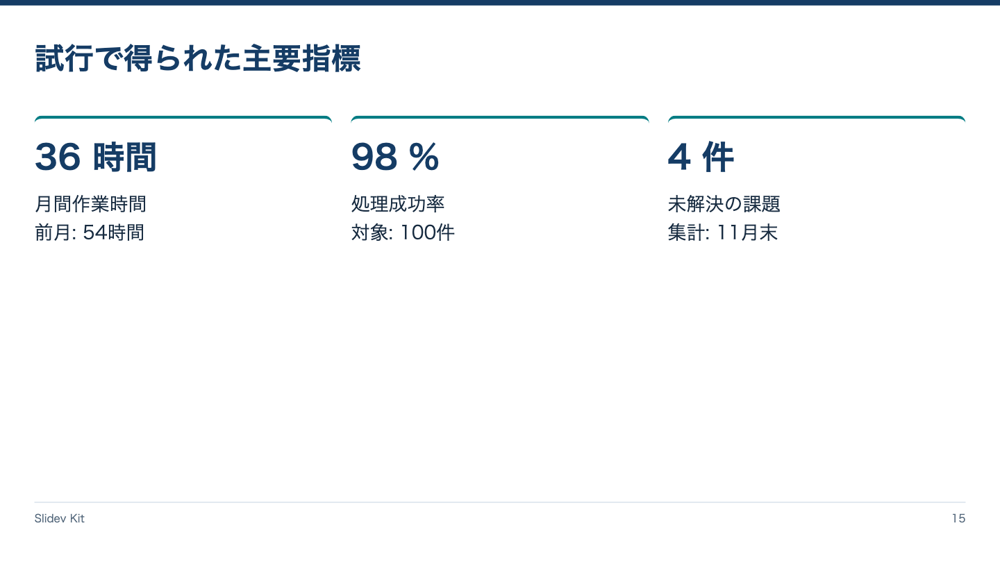

<!-- Generated by npm run catalog; edit packages/theme/registry/layouts.json -->
# 主要指標 / `metrics`

値と単位を指標名より大きく示す

カテゴリ: 図・分析



## コピーして使う

Corporateデッキの末尾へ、そのまま貼り付けてください。[初回セットアップ](../../docs/phase1/phase1-usage.md)。

[Markdownファイル](../templates/metrics.md)

````md
---
layout: metrics
variant: balanced
density: normal
---

# 試行で得られた主要指標

::first::

## 36 時間

月間作業時間\
前月: 54時間

::second::

## 98 %

処理成功率\
対象: 100件

::third::

## 4 件

未解決の課題\
集計: 11月末
````

## 設定・情報量

- Variant: `balanced`（既定: `balanced`）
- Density: `relaxed`, `normal`, `compact`（既定: `normal`）
- 情報量目安: 3指標固定、H2に値・単位、本文に名称・比較時点
- 名前付きslot: `first`（必須: first領域）, `second`（必須: second領域）, `third`（必須: third領域）

## 注意点

- Corporate / Editorial専用のKit契約。H1はちょうど1つ、named slotより前に置く。
- 情報量目安を超えた場合は警告を確認し、内容を削除・省略・自動縮小しない。

## AI向けメタデータ

以下は人間向けカタログと同じレジストリから生成しています。AIなしで利用できます。

```json
{
  "id": "metrics",
  "name": "主要指標",
  "category": "analysis",
  "description": "値と単位を指標名より大きく示す",
  "use_cases": [
    "metrics"
  ],
  "slots": [
    {
      "name": "first",
      "required": true,
      "description": "first領域"
    },
    {
      "name": "second",
      "required": true,
      "description": "second領域"
    },
    {
      "name": "third",
      "required": true,
      "description": "third領域"
    }
  ],
  "variants": [
    "balanced"
  ],
  "density": [
    "relaxed",
    "normal",
    "compact"
  ],
  "content_guide": "3指標固定、H2に値・単位、本文に名称・比較時点",
  "notes": [
    "Corporate / Editorial専用のKit契約。H1はちょうど1つ、named slotより前に置く。",
    "情報量目安を超えた場合は警告を確認し、内容を削除・省略・自動縮小しない。"
  ],
  "template": "catalog/templates/metrics.md",
  "preview": "catalog/previews/metrics.png"
}
```
