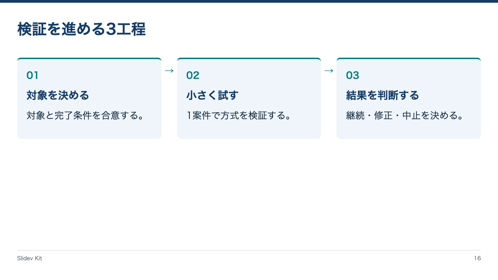

<!-- Generated by npm run catalog; edit packages/core/registry/layouts.json -->
# 工程 / `process`

番号と方向で3工程の順序を示す

カテゴリ: 計画



## コピーして使う

Corporateデッキの末尾へ、そのまま貼り付けてください。[初回セットアップ](../../docs/phase1/phase1-usage.md)。

[Markdownファイル](../templates/process.md)

````md
---
layout: process
variant: balanced
density: normal
---

# 検証を進める3工程

::first::

## 対象を決める

対象と完了条件を合意する。

::second::

## 小さく試す

1案件で方式を検証する。

::third::

## 結果を判断する

継続・修正・中止を決める。
````

## 設定・情報量

- Variant: `balanced`（既定: `balanced`）
- Density: `relaxed`, `normal`, `compact`（既定: `normal`）
- 情報量目安: 3工程固定、各見出し1行、説明2行まで
- 名前付きslot: `first`（必須: first領域）, `second`（必須: second領域）, `third`（必須: third領域）

## 注意点

- Corporate / Editorial専用のKit契約。H1はちょうど1つ、named slotより前に置く。
- 情報量目安を超えた場合は警告を確認し、内容を削除・省略・自動縮小しない。

## AI向けメタデータ

以下は人間向けカタログと同じレジストリから生成しています。AIなしで利用できます。

```json
{
  "id": "process",
  "name": "工程",
  "category": "planning",
  "description": "番号と方向で3工程の順序を示す",
  "use_cases": [
    "process"
  ],
  "slots": [
    {
      "name": "first",
      "required": true,
      "description": "first領域"
    },
    {
      "name": "second",
      "required": true,
      "description": "second領域"
    },
    {
      "name": "third",
      "required": true,
      "description": "third領域"
    }
  ],
  "variants": [
    "balanced"
  ],
  "density": [
    "relaxed",
    "normal",
    "compact"
  ],
  "content_guide": "3工程固定、各見出し1行、説明2行まで",
  "notes": [
    "Corporate / Editorial専用のKit契約。H1はちょうど1つ、named slotより前に置く。",
    "情報量目安を超えた場合は警告を確認し、内容を削除・省略・自動縮小しない。"
  ],
  "template": "catalog/templates/process.md",
  "preview": "catalog/previews/process.png"
}
```
