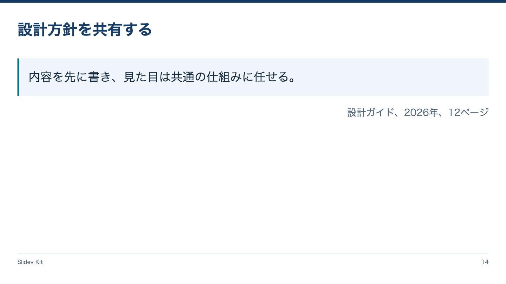

<!-- Generated by npm run catalog; edit packages/core/registry/layouts.json -->
# 引用 / `quote`

引用本文と帰属を独立して提示する

カテゴリ: 情報整理



## コピーして使う

Corporateデッキの末尾へ、そのまま貼り付けてください。[初回セットアップ](../../docs/phase1/phase1-usage.md)。

[Markdownファイル](../templates/quote.md)

````md
---
layout: quote
variant: balanced
density: normal
---

# 設計方針を共有する

::quote::

> 内容を先に書き、見た目は共通の仕組みに任せる。

::attribution::

設計ガイド、2026年、12ページ
````

## 設定・情報量

- Variant: `balanced`（既定: `balanced`）
- Density: `relaxed`, `normal`, `compact`（既定: `normal`）
- 情報量目安: 引用2〜4行、著者・資料名1〜2行
- 名前付きslot: `quote`（必須: blockquoteによる引用）, `attribution`（必須: 著者・資料名）

## 注意点

- Corporate / Editorial専用のKit契約。H1はちょうど1つ、named slotより前に置く。
- 情報量目安を超えた場合は警告を確認し、内容を削除・省略・自動縮小しない。

## AI向けメタデータ

以下は人間向けカタログと同じレジストリから生成しています。AIなしで利用できます。

```json
{
  "id": "quote",
  "name": "引用",
  "category": "information",
  "description": "引用本文と帰属を独立して提示する",
  "use_cases": [
    "quote"
  ],
  "slots": [
    {
      "name": "quote",
      "required": true,
      "description": "blockquoteによる引用"
    },
    {
      "name": "attribution",
      "required": true,
      "description": "著者・資料名"
    }
  ],
  "variants": [
    "balanced"
  ],
  "density": [
    "relaxed",
    "normal",
    "compact"
  ],
  "content_guide": "引用2〜4行、著者・資料名1〜2行",
  "notes": [
    "Corporate / Editorial専用のKit契約。H1はちょうど1つ、named slotより前に置く。",
    "情報量目安を超えた場合は警告を確認し、内容を削除・省略・自動縮小しない。"
  ],
  "template": "catalog/templates/quote.md",
  "preview": "catalog/previews/quote.png"
}
```
