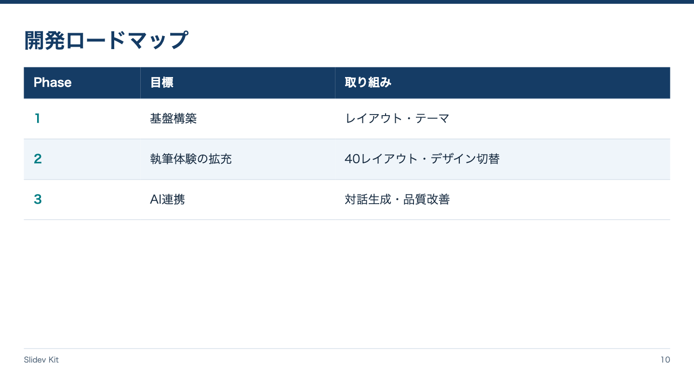

<!-- Generated by npm run catalog; edit packages/theme/registry/layouts.json -->
# ロードマップ / `roadmap`

段階ごとの目標と取り組みを伝える

カテゴリ: 計画



## コピーして使う

Corporateデッキの末尾へ、そのまま貼り付けてください。[初回セットアップ](../../docs/phase1/phase1-usage.md)。

[Markdownファイル](../templates/roadmap.md)

````md
---
layout: roadmap
variant: phases
density: normal
---

# 開発ロードマップ

| Phase | 目標 | 取り組み |
|---|---|---|
| 1 | 基盤構築 | レイアウト・テーマ |
| 2 | 執筆体験の拡充 | 40レイアウト・デザイン切替 |
| 3 | AI連携 | 対話生成・品質改善 |
````

## 設定・情報量

- Variant: `phases`（既定: `phases`）
- Density: `relaxed`, `normal`, `compact`（既定: `normal`）
- 情報量目安: 3〜5フェーズ、3列程度
- 名前付きslot: なし。本文をそのまま使用

## 注意点

- 標準Markdown表を表示する。Ganttや時間軸への自動変換ではない。
- phase名や時期は1列目に記載する。

## AI向けメタデータ

以下は人間向けカタログと同じレジストリから生成しています。AIなしで利用できます。

```json
{
  "id": "roadmap",
  "name": "ロードマップ",
  "category": "planning",
  "description": "段階ごとの目標と取り組みを伝える",
  "use_cases": [
    "development_plan",
    "adoption_plan",
    "phases"
  ],
  "slots": [],
  "variants": [
    "phases"
  ],
  "density": [
    "relaxed",
    "normal",
    "compact"
  ],
  "content_guide": "3〜5フェーズ、3列程度",
  "notes": [
    "標準Markdown表を表示する。Ganttや時間軸への自動変換ではない。",
    "phase名や時期は1列目に記載する。"
  ],
  "template": "catalog/templates/roadmap.md",
  "preview": "catalog/previews/roadmap.png"
}
```
