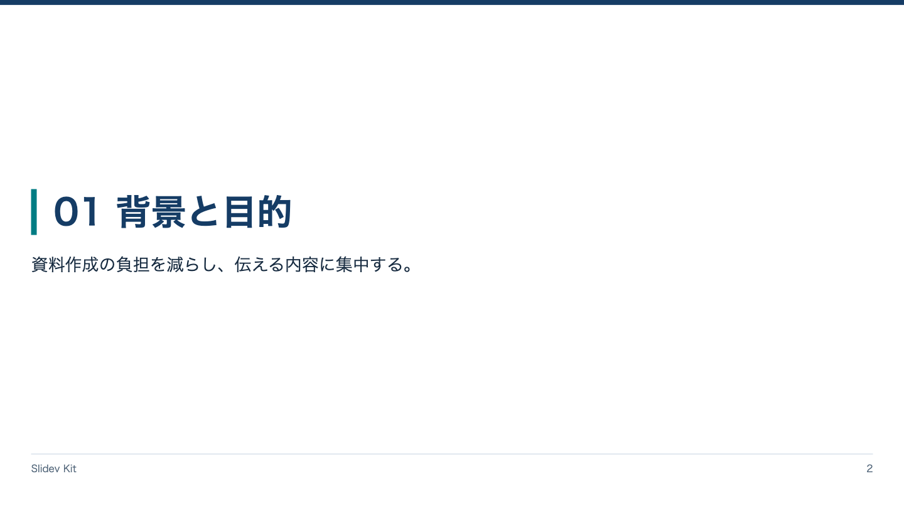

<!-- Generated by npm run catalog; edit packages/core/registry/layouts.json -->
# 章扉 / `section`

話題の切り替えと章の目的を示す

カテゴリ: 構成・本文



## コピーして使う

Corporateデッキの末尾へ、そのまま貼り付けてください。[初回セットアップ](../../docs/phase1/phase1-usage.md)。

[Markdownファイル](../templates/section.md)

````md
---
layout: section
variant: balanced
density: normal
---

# 01 背景と目的

資料作成の負担を減らし、伝える内容に集中する。
````

## 設定・情報量

- Variant: `balanced`, `dramatic`（既定: `balanced`）
- Density: `relaxed`, `normal`, `compact`（既定: `normal`）
- 情報量目安: 章タイトル1行、説明1〜2行
- 名前付きslot: なし。本文をそのまま使用

## 注意点

- 詳細な説明は次のcontentへ分ける。

## AI向けメタデータ

以下は人間向けカタログと同じレジストリから生成しています。AIなしで利用できます。

```json
{
  "id": "section",
  "name": "章扉",
  "category": "presentation",
  "description": "話題の切り替えと章の目的を示す",
  "use_cases": [
    "chapter",
    "transition"
  ],
  "slots": [],
  "variants": [
    "balanced",
    "dramatic"
  ],
  "density": [
    "relaxed",
    "normal",
    "compact"
  ],
  "content_guide": "章タイトル1行、説明1〜2行",
  "notes": [
    "詳細な説明は次のcontentへ分ける。"
  ],
  "template": "catalog/templates/section.md",
  "preview": "catalog/previews/section.png"
}
```
