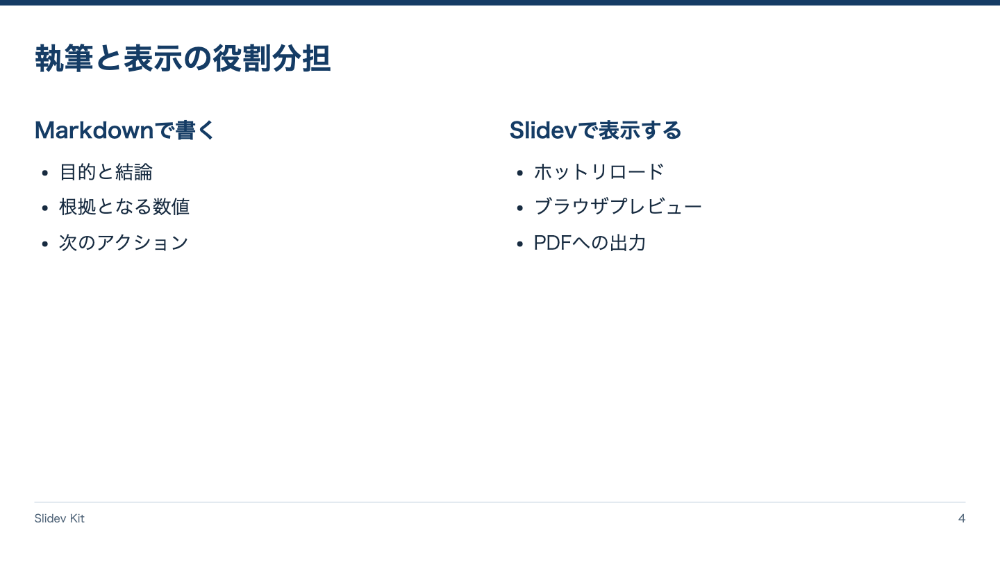

<!-- Generated by npm run catalog; edit packages/theme/registry/layouts.json -->
# 2カラム / `split`

説明と補足情報を左右に配置する

カテゴリ: 比較・論理



## コピーして使う

Corporateデッキの末尾へ、そのまま貼り付けてください。[初回セットアップ](../../docs/phase1/phase1-usage.md)。

[Markdownファイル](../templates/split.md)

````md
---
layout: split
variant: balanced
density: normal
---

# 執筆と表示の役割分担

::left::

## Markdownで書く

- 目的と結論
- 根拠となる数値
- 次のアクション

::right::

## Slidevで表示する

- ホットリロード
- ブラウザプレビュー
- PDFへの出力
````

## 設定・情報量

- Variant: `balanced`, `left`, `right`（既定: `balanced`）
- Density: `relaxed`, `normal`, `compact`（既定: `normal`）
- 情報量目安: 各カラム見出し1つ、箇条書き3項目程度
- 名前付きslot: `left`（必須: 左側の説明）, `right`（必須: 右側の補足・図）

## 注意点

- H1はスロット指定の前に置く。left/rightは左右の領域を広くするvariant。

## AI向けメタデータ

以下は人間向けカタログと同じレジストリから生成しています。AIなしで利用できます。

```json
{
  "id": "split",
  "name": "2カラム",
  "category": "logic",
  "description": "説明と補足情報を左右に配置する",
  "use_cases": [
    "explanation_and_evidence",
    "text_and_diagram"
  ],
  "slots": [
    {
      "name": "left",
      "required": true,
      "description": "左側の説明"
    },
    {
      "name": "right",
      "required": true,
      "description": "右側の補足・図"
    }
  ],
  "variants": [
    "balanced",
    "left",
    "right"
  ],
  "density": [
    "relaxed",
    "normal",
    "compact"
  ],
  "content_guide": "各カラム見出し1つ、箇条書き3項目程度",
  "notes": [
    "H1はスロット指定の前に置く。left/rightは左右の領域を広くするvariant。"
  ],
  "template": "catalog/templates/split.md",
  "preview": "catalog/previews/split.png"
}
```
