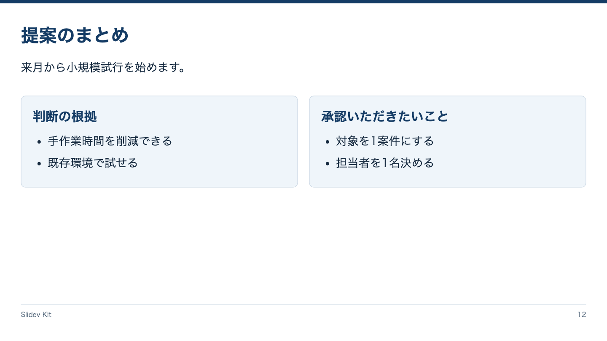

<!-- Generated by npm run catalog; edit packages/theme/registry/layouts.json -->
# まとめ / `summary`

結論から根拠と判断依頼へつなぐ

カテゴリ: 比較・論理



## コピーして使う

Corporateデッキの末尾へ、そのまま貼り付けてください。[初回セットアップ](../../docs/phase1/phase1-usage.md)。

[Markdownファイル](../templates/summary.md)

````md
---
layout: summary
variant: balanced
density: normal
---

# 提案のまとめ

来月から小規模試行を始めます。

::evidence::

## 判断の根拠

- 手作業時間を削減できる
- 既存環境で試せる

::request::

## 承認いただきたいこと

- 対象を1案件にする
- 担当者を1名決める
````

## 設定・情報量

- Variant: `balanced`（既定: `balanced`）
- Density: `relaxed`, `normal`, `compact`（既定: `normal`）
- 情報量目安: 冒頭結論1〜2文、各slot2〜3項目
- 名前付きslot: `evidence`（必須: 判断の根拠）, `request`（必須: 判断依頼）

## 注意点

- Corporate / Editorial専用のKit契約。H1はちょうど1つ、named slotより前に置く。
- 情報量目安を超えた場合は警告を確認し、内容を削除・省略・自動縮小しない。

## AI向けメタデータ

以下は人間向けカタログと同じレジストリから生成しています。AIなしで利用できます。

```json
{
  "id": "summary",
  "name": "まとめ",
  "category": "logic",
  "description": "結論から根拠と判断依頼へつなぐ",
  "use_cases": [
    "summary"
  ],
  "slots": [
    {
      "name": "evidence",
      "required": true,
      "description": "判断の根拠"
    },
    {
      "name": "request",
      "required": true,
      "description": "判断依頼"
    }
  ],
  "variants": [
    "balanced"
  ],
  "density": [
    "relaxed",
    "normal",
    "compact"
  ],
  "content_guide": "冒頭結論1〜2文、各slot2〜3項目",
  "notes": [
    "Corporate / Editorial専用のKit契約。H1はちょうど1つ、named slotより前に置く。",
    "情報量目安を超えた場合は警告を確認し、内容を削除・省略・自動縮小しない。"
  ],
  "template": "catalog/templates/summary.md",
  "preview": "catalog/previews/summary.png"
}
```
