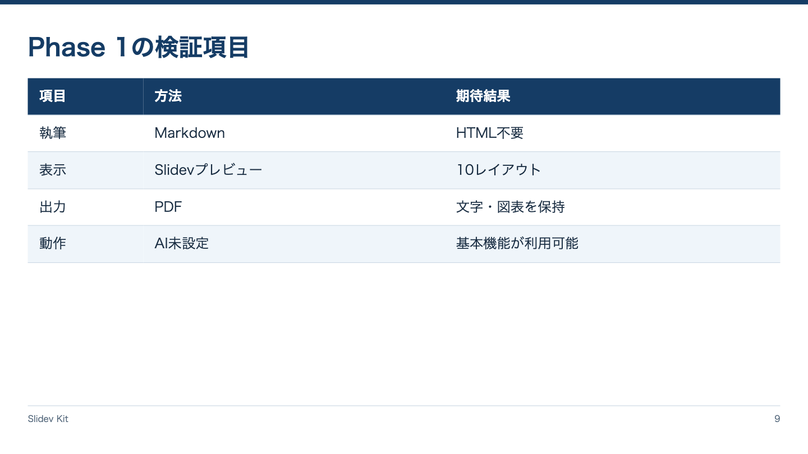

<!-- Generated by npm run catalog; edit packages/theme/registry/layouts.json -->
# データ表 / `table`

仕様や数値を行と列で整理する

カテゴリ: 情報整理



## コピーして使う

Corporateデッキの末尾へ、そのまま貼り付けてください。[初回セットアップ](../../docs/phase1/phase1-usage.md)。

[Markdownファイル](../templates/table.md)

````md
---
layout: table
variant: balanced
density: normal
---

# Phase 1の検証項目

| 項目 | 方法 | 期待結果 |
|---|---|---|
| 執筆 | Markdown | HTML不要 |
| 表示 | Slidevプレビュー | 10レイアウト |
| 出力 | PDF | 文字・図表を保持 |
| 動作 | AI未設定 | 基本機能が利用可能 |
````

## 設定・情報量

- Variant: `balanced`（既定: `balanced`）
- Density: `relaxed`, `normal`, `compact`（既定: `normal`）
- 情報量目安: 3〜5列、3〜6行。compactでも8行程度まで
- 名前付きslot: なし。本文をそのまま使用

## 注意点

- 通常のMarkdown表。独自変換を行わず、データを削除しない。

## AI向けメタデータ

以下は人間向けカタログと同じレジストリから生成しています。AIなしで利用できます。

```json
{
  "id": "table",
  "name": "データ表",
  "category": "information",
  "description": "仕様や数値を行と列で整理する",
  "use_cases": [
    "specifications",
    "measurements",
    "comparison_table"
  ],
  "slots": [],
  "variants": [
    "balanced"
  ],
  "density": [
    "relaxed",
    "normal",
    "compact"
  ],
  "content_guide": "3〜5列、3〜6行。compactでも8行程度まで",
  "notes": [
    "通常のMarkdown表。独自変換を行わず、データを削除しない。"
  ],
  "template": "catalog/templates/table.md",
  "preview": "catalog/previews/table.png"
}
```
