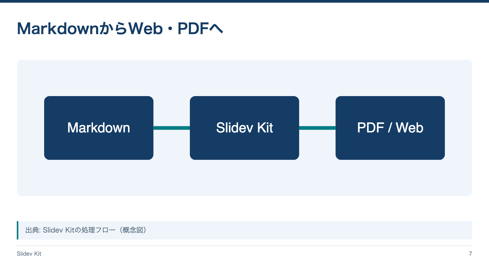

<!-- Generated by npm run catalog; edit packages/core/registry/layouts.json -->
# 図・画像中心 / `visual`

画像やシステム図を大きく示す

カテゴリ: 図・分析



## コピーして使う

Corporateデッキの末尾へ、そのまま貼り付けてください。[初回セットアップ](../../docs/phase1/phase1-usage.md)。

[Markdownファイル](../templates/visual.md)

````md
---
layout: visual
variant: balanced
density: normal
---

# MarkdownからWeb・PDFへ


> 出典: Slidev Kitの処理フロー（概念図）
````

## 設定・情報量

- Variant: `balanced`（既定: `balanced`）
- Density: `relaxed`, `normal`, `compact`（既定: `normal`）
- 情報量目安: 画像1点、タイトルと出典各1行
- 名前付きslot: なし。本文をそのまま使用

## 注意点

- 通常はpublic/images/に画像を置き /images/name.png を指定する。
- この例はテーマ同梱の /slidev-kit/pipeline.svg を使うため、コピーだけで動く。altは画像の説明に置き換える。

## AI向けメタデータ

以下は人間向けカタログと同じレジストリから生成しています。AIなしで利用できます。

```json
{
  "id": "visual",
  "name": "図・画像中心",
  "category": "analysis",
  "description": "画像やシステム図を大きく示す",
  "use_cases": [
    "system_image",
    "simulation",
    "illustration"
  ],
  "slots": [],
  "variants": [
    "balanced"
  ],
  "density": [
    "relaxed",
    "normal",
    "compact"
  ],
  "content_guide": "画像1点、タイトルと出典各1行",
  "notes": [
    "通常はpublic/images/に画像を置き /images/name.png を指定する。",
    "この例はテーマ同梱の /slidev-kit/pipeline.svg を使うため、コピーだけで動く。altは画像の説明に置き換える。"
  ],
  "template": "catalog/templates/visual.md",
  "preview": "catalog/previews/visual.png"
}
```
