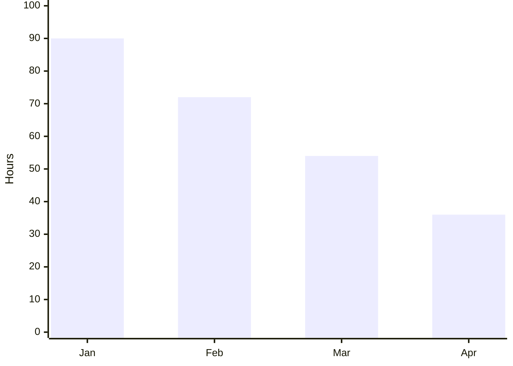

# 技術報告を、もっとシンプルに

Write content. Let design happen.

開発チーム / 2026年11月

---
layout: section
variant: balanced
density: normal
---

# 01 背景と目的

資料作成の負担を減らし、伝える内容に集中する。

---
layout: content
variant: balanced
density: normal
---

# 内容に集中できる執筆環境

## Markdownを共通言語にする

- **文章**はいつものエディタで編集
- **構造**はレイアウトで選択
- **装飾**はデザイントークンに委譲

> 人間もAIも、同じ編集可能なファイルを扱う。

---
layout: split
variant: balanced
density: normal
---

# 執筆と表示の役割分担

::left::

## Markdownで書く

- 目的と結論
- 根拠となる数値
- 次のアクション

::right::

## Slidevで表示する

- ホットリロード
- ブラウザプレビュー
- PDFへの出力

---
layout: comparison
variant: balanced
density: normal
---

# 新旧方式の比較

::left::

## 従来

- 手動設定
- 個別処理
- 毎回の体裁調整

::right::

## 改善後

- 自動設定
- 標準化
- 共通デザイン

---
layout: cards
variant: balanced
density: normal
---

# 3つの設計原則

::first::

## 書きやすい

標準Markdownと名前付きスロットで編集する。

::second::

## 揃えやすい

色・文字・余白を共通トークンで統一する。

::third::

## 続けやすい

AIなしで動作し、将来の拡張も妨げない。

---
layout: visual
variant: balanced
density: normal
---

# MarkdownからWeb・PDFへ

> 出典: Slidev Kitの処理フロー（概念図）

---
layout: chart
variant: balanced
density: normal
---

# 自動化による作業時間の推移

> データ: 説明用の架空値。単位は時間。

---
layout: table
variant: balanced
density: normal
---

# Phase 1の検証項目

| 項目 | 方法 | 期待結果 |
|---|---|---|
| 執筆 | Markdown | HTML不要 |
| 表示 | Slidevプレビュー | 10レイアウト |
| 出力 | PDF | 文字・図表を保持 |
| 動作 | AI未設定 | 基本機能が利用可能 |

---
layout: roadmap
variant: phases
density: normal
---

# 開発ロードマップ

| Phase | 目標 | 取り組み |
|---|---|---|
| 1 | 基盤構築 | レイアウト・テーマ |
| 2 | 執筆体験の拡充 | 40レイアウト・デザイン切替 |
| 3 | AI連携 | 対話生成・品質改善 |
